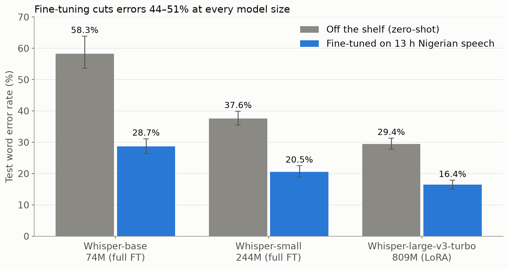
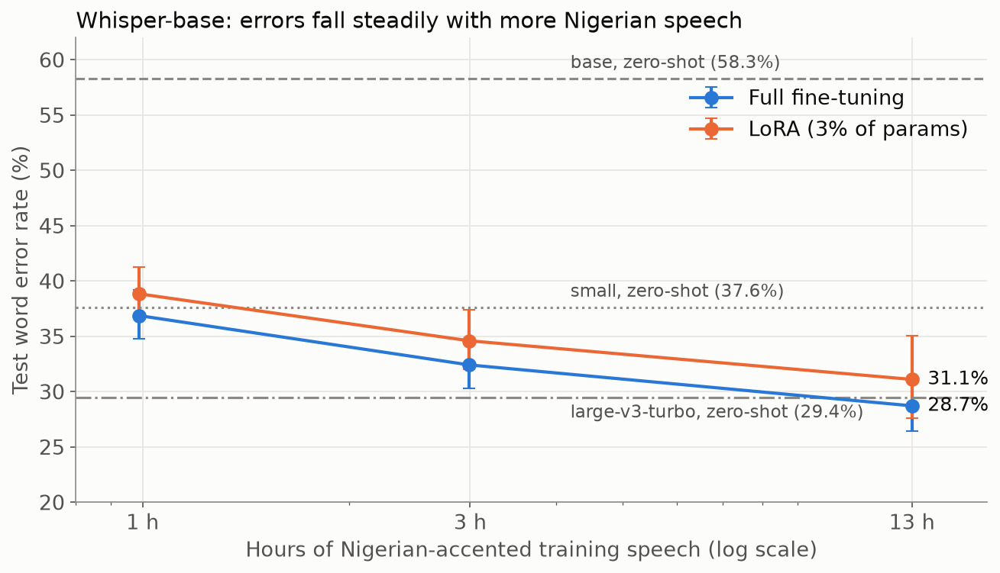
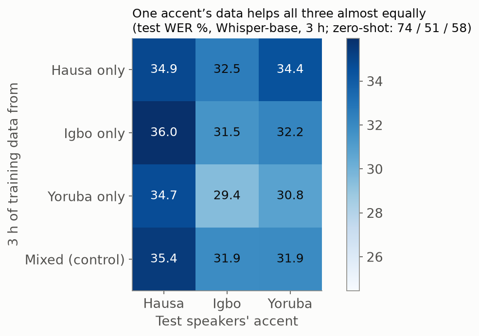
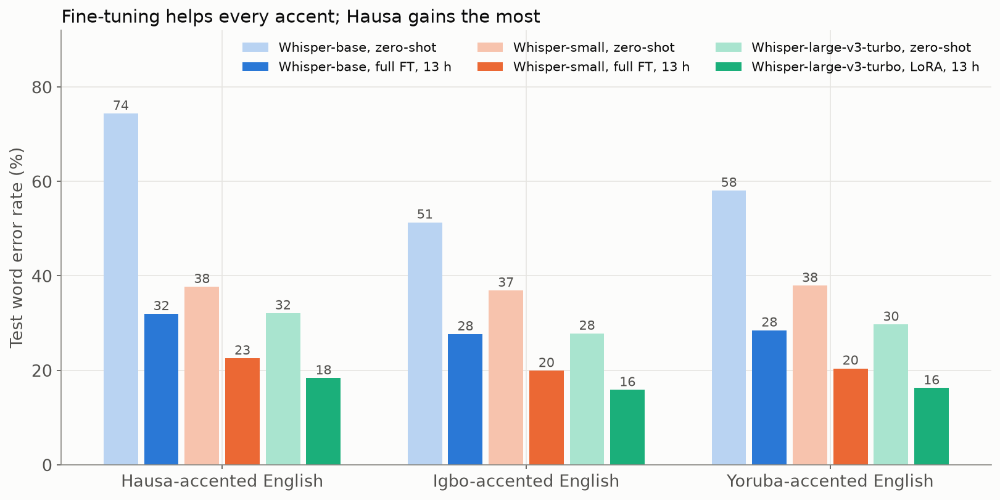
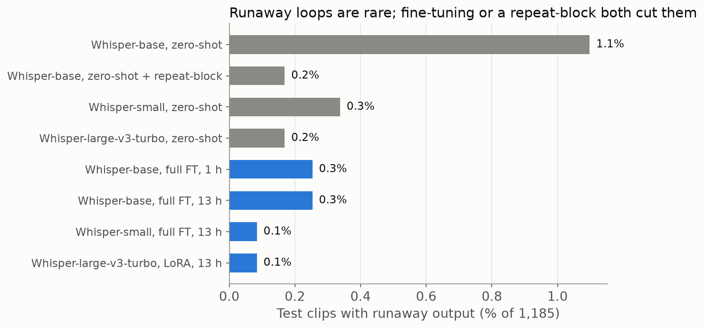

# Teaching Whisper to Hear Nigerian English

Off-the-shelf speech recognition gets roughly 1 in 3 words wrong on Nigerian-accented English. This project fine-tunes OpenAI's [Whisper](https://github.com/openai/whisper) on Yoruba-, Igbo- and Hausa-accented English from [AfriSpeech-200](https://huggingface.co/datasets/intronhealth/afrispeech-200), and measures what it takes to close the gap: how much data, which fine-tuning method, and what model size.

**Headline:** LoRA fine-tuning of Whisper-large-v3-turbo on 13 hours of Nigerian speech cut test word error rate (WER) from **29.4% to 16.4%** on speakers the model never heard, while training only **1.6%** of its weights.



## Findings

1. **Fine-tuning roughly halves the error rate at every model size** (44–51% relative reduction), with 13 hours of accented speech.
2. **A bigger model with LoRA beats a smaller model with full fine-tuning.** LoRA on the 809M-parameter model (13.1M trainable) reached 16.4% WER; fully fine-tuning the 244M model reached 19.9%.
3. **Accents transfer.** Training on 3 hours of a single accent improved all three accents about equally; the matching accent gained under 1 point on average. The model learns "Nigerian English", not one accent at a time.
4. **Data matters more than steps.** Going from 1 h → 3 h → 13 h kept improving results, while training 2.5× longer on the same data gained only 0.6 points.
5. **Raw WER can mislead.** Part of the zero-shot error comes from formatting (writing "comma" instead of ",") and from rare repetition loops: 1.2% of Whisper-base clips that add about 7 WER points. Blocking repeats at decoding time removes the loops but not the underlying recognition errors.
6. **Large models need a lower learning rate.** LoRA on large-v3-turbo at lr 1e-3 (fine for smaller models) diverged and collapsed into repeating one sentence (158.7% WER); lr 1e-4 trained cleanly.

## Results

Test set: 1,185 clips (2.98 h) from 317 speakers, none of whom appear in training. 95% confidence intervals come from bootstrap resampling over speakers.

| Model | Method | Training data | Trainable params | Test WER (95% CI) |
|---|---|---|---|---|
| Whisper-base (74M) | zero-shot | — | — | 58.3% (53.7–63.9) |
| Whisper-small (244M) | zero-shot | — | — | 37.6% (35.5–39.9) |
| Whisper-large-v3-turbo (809M) | zero-shot | — | — | 29.4% (27.7–31.3) |
| Whisper-base | full fine-tune | 1 h / 3 h / 13 h | 72.6M | 36.9% / 32.4% / 28.7% |
| Whisper-base | LoRA | 1 h / 3 h / 13 h | 2.4M | 38.8% / 34.6% / 31.1% |
| Whisper-small | LoRA | 13 h | 7.1M | 21.3% (19.4–23.2) |
| Whisper-small | full fine-tune | 13 h | 241.7M | 20.5% (18.8–22.5) |
| Whisper-small | full fine-tune, 1,500 steps | 13 h | 241.7M | 19.9% (18.2–21.7) |
| **Whisper-large-v3-turbo** | **LoRA (r=32), lr 1e-4** | **13 h** | **13.1M** | **16.4% (15.0–17.9)** |

Cross-accent transfer (Whisper-base, full fine-tune, 3 h of one accent, WER on each test accent):

| Trained on ↓ / Tested on → | Hausa | Igbo | Yoruba |
|---|---|---|---|
| Hausa only | 34.9 | 32.5 | 34.4 |
| Igbo only | 36.0 | 31.5 | 32.2 |
| Yoruba only | 34.7 | 29.4 | 30.8 |

Full numbers are in [analysis/summary.csv](analysis/summary.csv), example transcripts in [analysis/examples.md](analysis/examples.md), and per-clip predictions in [results/](results/).

| | |
|---|---|
|  |  |
|  |  |

## Setup

- **Data:** Hausa, Igbo and Yoruba subsets of AfriSpeech-200. Train 4,772 clips (13.2 h, 740 speakers), dev 689 clips (1.7 h), test 1,185 clips (3.0 h, 317 speakers). Audio is resampled from 44.1 kHz stereo to 16 kHz mono.
- **Training:** AdamW with 10% linear warmup, 600 steps at an effective batch size of 16. Learning rate 1e-5 for full fine-tuning, 1e-3 for LoRA (1e-4 for large-v3-turbo). LoRA uses r=32, alpha=64 on the attention q/k/v/out projections. The checkpoint with the lowest dev loss is kept.
- **Scoring:** WER with Whisper's English text normalizer (via [jiwer](https://github.com/jitsi/jiwer)), plus a hallucination rate and a punctuation-neutral WER that doesn't penalize dictated punctuation.
- **Compute:** Whisper-base and small on an Apple M4 Pro (24 GB, PyTorch MPS); large-v3-turbo on an NVIDIA A100 40 GB on Texas A&M's Grace cluster (Slurm). The A100 ran about 4× faster per step.

## Reproduce

```bash
python -m venv .venv && source .venv/bin/activate
pip install -r requirements.txt

python scripts/download_data.py      # AfriSpeech-200 Hausa/Igbo/Yoruba → data/afrispeech/
python scripts/build_manifest.py     # train/dev/test manifests
python scripts/resample.py           # 16 kHz mono wavs

bash scripts/run_all.sh              # zero-shot baselines, data scaling, LoRA vs full, whisper-small
bash scripts/run_extra.sh            # cross-accent runs, repeat-blocking decoding
sbatch grace/job.slurm               # on a GPU cluster: large-v3-turbo, longer whisper-small run
sbatch grace/job_large.slurm         # large-v3-turbo LoRA at lr 1e-4
python scripts/analyze.py            # tables, bootstrap CIs and figures → analysis/
```

Single runs:

```bash
python scripts/train.py my_run --model openai/whisper-small --hours 3 --lora
python scripts/evaluate.py checkpoints/my_run my_run
```

Model weights are not included (about 2.6 GB); `checkpoints/` holds only each run's training log.

## Limitations

- One random seed per run; confidence intervals reflect speaker variation, not training variance.
- Three of Nigeria's many accents, and 13 of AfriSpeech's 200 hours.
- 16% WER is still too high for clinical use; drug names remain hard.
- Not checked for forgetting on standard American/British English benchmarks.

## Acknowledgments

Built on Whisper (Radford et al., 2022), AfriSpeech-200 (Olatunji et al., 2023; CC BY-NC-SA 4.0), LoRA (Hu et al., 2021) and the Hugging Face Transformers and PEFT libraries. Compute provided by Texas A&M High Performance Research Computing. Course project for CSCE 636 (Deep Learning), Texas A&M University, Fall 2026.
